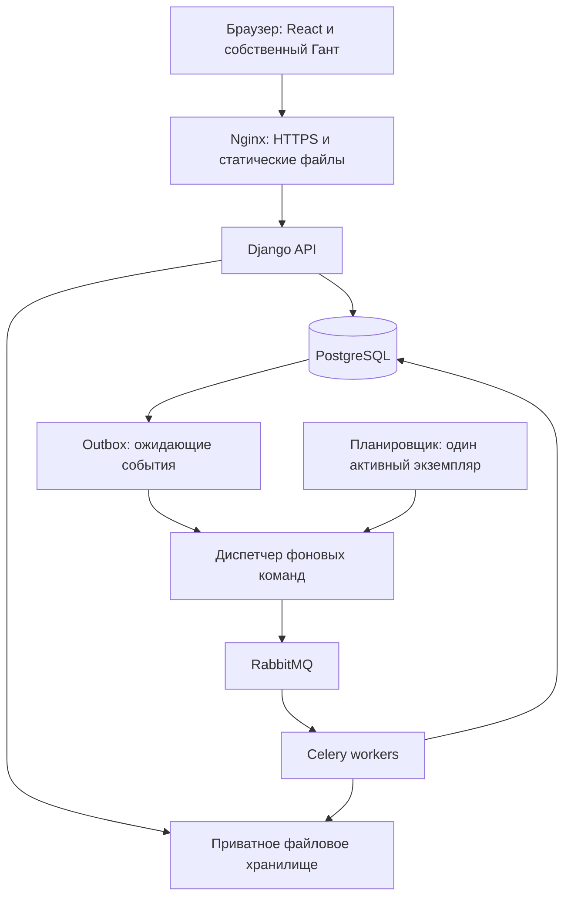

# TechPlan — технический план разработки «ПИР Контроль»

**Версия:** 1.0  
**Дата:** 09.10.2026  
**Основание:** [PRD «ПИР Контроль»](./PRD_ПИР.md), версия 1.0, и последующие решения заказчика.  
**Статус:** план реализации; приложение и перечисленная инфраструктура ещё не созданы.  
**Исполнитель разработки:** Codex в рабочем репозитории заказчика.  
**Размещение:** сервер организации либо облачная инфраструктура с теми же контейнерами приложения.

## 1. Зафиксированные решения

1. Интерфейс — React и TypeScript; серверная часть — Python, Django и Django REST Framework; основная база — PostgreSQL.
2. Диаграмма Ганта разрабатывается самостоятельно. Готовые коммерческие или бесплатные Gantt-компоненты не включаются в продукт. Допускаются общие библиотеки таблиц, виртуализации, форм и интерфейсных элементов.
3. Правила календаря, сетевых зависимостей, критического пути, стоимости и исторических отчётов реализуются в нашем серверном коде.
4. Пользователь задаёт сроки вручную. Автоматическое перемещение зависимых работ не включается ни при перетаскивании, ни при сохранении, ни при расчёте CPM.
5. Архитектура — модульный монолит: один backend с предметными модулями, отдельными процессами API, фоновых исполнителей и планировщика.
6. API, интерфейс и приватные файлы доступны через один домен. Способ размещения меняет конфигурацию, а не бизнес-логику.
7. Производственные данные и расчёты не отправляются внешним сервисам Ганта, экспорта или аналитики.
8. Первая производственная версия покрывает P0 из PRD. Промежуточные работающие сборки допускаются, но не обозначаются как завершённый продукт.

Технологический план уточняет способ реализации PRD. Последующее решение заказчика о собственном Ганте заменяет ранее обсуждавшийся вариант DHTMLX/Bryntum. Изменения продуктовых правил оформляются отдельным решением и отражаются в обоих документах.

## 2. Технологический стек

### 2.1. Основные компоненты

| Слой | Выбор | Задача и граница ответственности |
| --- | --- | --- |
| Frontend | React 19, TypeScript в строгом режиме, Vite 8 | SPA с реестрами, редактором графика, Гантом и отчётами |
| Сборка frontend | Node.js 24 LTS, pnpm | Сборка и инструменты разработки; в production интерфейс раздаётся как статические файлы |
| Маршрутизация | React Router | Страницы, URL-фильтры, переходы к объектам и графикам |
| Серверные данные в UI | TanStack Query | Запросы, кеш интерфейса, загрузка, повторное получение после изменений |
| Реестры | TanStack Table + TanStack Virtual | Табличная логика и отображение только видимых строк |
| Собственный Гант | React + HTML/CSS + SVG + TanStack Virtual | Шкала времени, полосы, события, зависимости и ручное редактирование |
| Формы и UI | React Hook Form, Zod, Radix UI, CSS Modules | Валидация ввода, доступные примитивы, собственное оформление |
| Backend | Python 3.13, Django 5.2 LTS, Django REST Framework | Прикладные команды, доступ, согласование, история и API |
| Контракты | OpenAPI через drf-spectacular; TypeScript-типы из схемы | Согласованность frontend и backend |
| База | PostgreSQL 18, psycopg 3, Django ORM | Транзакционные данные, исторические записи, отчёты |
| Фоновые операции | Celery 5.6 + RabbitMQ 4.x | Импорт, экспорт, крупные расчёты, уведомления и обслуживание |
| Состояние заданий | PostgreSQL, таблица BackgroundJob | Прогресс, результат, ошибки и контроль повторов |
| Excel | XlsxWriter + openpyxl | Создание XLSX и чтение загруженных файлов соответственно |
| Приватные файлы | Адаптер локального хранилища; адаптер S3 API | Импортируемые файлы, снимки отчётов, выгрузки |
| HTTP и раздача UI | Nginx + Gunicorn | HTTPS, статика, проксирование API и защищённое скачивание |
| Развёртывание | Docker Engine + Docker Compose на Linux | Общая схема запуска на своём сервере и облачной VM |
| Backend-проверки | pytest, pytest-django, Hypothesis, Ruff | Проверка предметных правил, интеграций и качества кода |
| Frontend-проверки | Vitest, Testing Library, Playwright, ESLint | Геометрия Ганта, формы, сценарии браузера |
| Нагрузка | k6 | API и фоновые операции под нагрузкой PRD |

В таблице указаны целевые семейства версий, а не утверждение о последних выпусках. В M0 проверяются поддержка, совместимость и исправления безопасности; точные версии фиксируются в `pnpm-lock.yaml`, `uv.lock` и образах контейнеров по digest. Использование тега `latest` в производственном развёртывании запрещается проектным правилом. Если выбранная ветка перестала поддерживаться к началу реализации, принимается совместимая поддерживаемая версия с записью в ADR.

Для React/Vite используется официальный TypeScript-шаблон. Возможность такого проекта описана в [руководстве Vite](https://vite.dev/guide/). Семейства React и Node проверяются по [списку версий React](https://react.dev/versions) и [циклу поддержки Node.js](https://nodejs.org/en/about/previous-releases). Django 5.2 выбран как LTS с указанной проектом расширенной поддержкой до апреля 2028 года; перед этой датой планируется обновление. [Цикл поддержки Django](https://www.djangoproject.com/download/).

### 2.2. Почему выбран такой состав

- React подходит для самостоятельной реализации интерактивного редактора; TypeScript фиксирует контракты узлов, связей и пользовательских действий.
- Django предоставляет основу для пользователей, миграций, транзакций и административных справочников. Экраны ГИПа, координации и директоров создаются в React. [Назначение Django Admin](https://docs.djangoproject.com/en/5.2/ref/contrib/admin/).
- PostgreSQL хранит связанные версии планов и фактов в транзакциях. Денежные суммы используют точные десятичные типы. [Тип numeric](https://www.postgresql.org/docs/current/datatype-numeric.html).
- RabbitMQ выбран как транспорт фоновых команд. Результаты и состояние выполнения остаются в PostgreSQL, поэтому отдельный Redis для P0 не нужен. Celery документирует поддержку RabbitMQ как брокера. [Брокеры Celery](https://docs.celeryq.dev/en/stable/getting-started/backends-and-brokers/index.html).
- Собственный Гант и серверный расчёт устраняют зависимость предметной модели от формата данных поставщика компонента. Стоимость этого решения — отдельный объём разработки и тестирования графического редактора.

Общие библиотеки выбираются без обязательной покупки коммерческих UI-модулей. Их версии, лицензии и уведомления фиксируются в реестре зависимостей. Владение исходным кодом приложения не означает отсутствие лицензий у его зависимостей.

## 3. Архитектура приложения



API и workers используют один образ backend и один набор предметных функций. Отдельный worker-процесс не является самостоятельным микросервисом. Внутренние вызовы между модулями выполняются в Python; HTTP используется на границе клиента.

### 3.1. Модули backend

| Модуль | Содержимое |
| --- | --- |
| `identity` | Учётные записи, роли, области доступа, сессии, MFA |
| `directory` | Специальности, отделы, сотрудники, стадии, причины задержек |
| `portfolio` | Объекты, стадии объектов, этапы и версии границ этапов |
| `network_models` | Модели, версии, публикация, технологические шаблоны |
| `schedules` | Графики, рабочие редакции, снимки плана, участия, интервалы, передачи |
| `calendars` | Версии производственных календарей и рабочая арифметика |
| `planning` | Проверка DAG, зависимости, CPM, ручной прогноз |
| `workflow` | Отправка, утверждение, возврат, продление, отмена и приостановка |
| `execution` | Факт, исправления, готовность, задержки и актуальность |
| `reporting` | Исторические срезы, R-01–R-12, загрузка, снимки |
| `exchange` | XLSX-шаблоны, предварительная проверка импорта, выгрузки А4 |
| `notifications` | Внутренние уведомления и правила адресации |
| `audit` | Неизменяемый журнал бизнес-действий |
| `jobs` | Очередь прикладных заданий, outbox, повторные попытки |

Модуль владеет изменениями своих данных. Обработчик API вызывает прикладной сервис; в сериализаторе нет расчёта CPM или процесса утверждения. Сложные выборки вынесены в функции чтения. Чистые календарные и сетевые алгоритмы не зависят от HTTP, ORM и Celery.

### 3.2. Структура будущего репозитория

```text
/
├── PRD_ПИР.md
├── TechPlan.md
├── README.md
├── apps/
│   ├── web/
│   │   ├── src/app/
│   │   ├── src/features/
│   │   ├── src/shared/api/
│   │   ├── src/shared/ui/
│   │   └── tests/
│   └── api/
│       ├── config/
│       ├── modules/
│       ├── tests/
│       ├── manage.py
│       ├── pyproject.toml
│       └── uv.lock
├── packages/
│   ├── gantt-core/
│   └── gantt-react/
├── contracts/
│   ├── openapi.yaml
│   └── fixtures/
├── infra/
│   ├── compose.yaml
│   ├── compose.dev.yaml
│   ├── compose.prod.yaml
│   ├── nginx/
│   └── backup/
├── docs/
│   ├── adr/
│   ├── operations/
│   └── acceptance/
├── scripts/
├── pnpm-workspace.yaml
└── pnpm-lock.yaml
```

Это план структуры. Наличие пути в документе не означает, что файл уже создан.

## 4. Модель данных и идентификаторы

### 4.1. Иерархия

`Object → ObjectStage → WorkPhase → Schedule → Participation → WorkInterval / Handoff`.

Термины `ObjectStage` и `WorkPhase` разделяют стадию проектирования и этап календарного плана. Публичные идентификаторы — UUID; шифры объектов, моделей и специальностей — строковые поля. Значения `062` и `06-2` не преобразуются в числа или даты.

### 4.2. Таблицы и версии

| Группа | Основные таблицы | Правила |
| --- | --- | --- |
| Доступ | User, RoleAssignment, ScopeAssignment, Delegation | Роль и область действия разделены; замещение имеет период |
| Справочники | Specialty, Department, Employee, DesignStage, DelayReason | Используемые записи архивируются; связи с историей сохраняются |
| Портфель | Object, ObjectStage, WorkPhase, WorkPhaseVersion | Утверждённые графики ссылаются на версию этапа |
| Библиотека | NetworkModel, NetworkModelVersion, TemplateNode, TemplateEdge, TemplateHandoff | Опубликованная версия неизменяема |
| График | Schedule, ScheduleRevision, ModelInstance | Schedule хранит стабильную идентичность и ссылки на исходный/действующий план |
| Состав версии | ParticipationRevision, IntervalRevision, EventRevision, HandoffRevision, HandoffParty, DependencyRevision | Каждая запись принадлежит конкретной редакции; стабильный logical_id связывает её историю |
| Календарь | Calendar, CalendarVersion, CalendarDay | Версия содержит неизменяемый набор дней за весь покрытый период |
| Согласование | ApprovalSubmission, ApprovalDecision, ChangeRequest | Отправленная редакция замораживается; повторная отправка создаёт новый снимок |
| Исполнение | FactObservation, FactCorrection, StatusEvent | Добавление записей; исправление не уничтожает исходный факт |
| Расчёты | CalculationRun, CalculationNodeResult | Ключ содержит версии входов и алгоритма; результат воспроизводим |
| Отчёты | ReportRequest, ReportSnapshot, ReportArtifact, ScopeManifest | Снимок фиксирует значения, фильтры, версии и область доступа |
| Обмен | ImportBatch, ImportStagingRow, ImportIssue, ExternalIdMap | Применение отделено от чтения и проверки файла |
| Фоновые операции | BackgroundJob, OutboxEvent, Notification | Прикладная идемпотентность и восстановление после сбоя |
| Аудит | AuditEvent | Кто, что, когда, причина, источник, до/после |

Реляционные поля используются для зависимостей, дат, сумм и прав. JSONB применяется для диагностик, неизменяемых payload снимков и метаданных; основная сеть не хранится одним непрозрачным JSON-документом.

### 4.3. Типы и ограничения

- Сроки работ: PostgreSQL `date`; дата не содержит часового пояса.
- Моменты ввода, утверждения и аудита: `timestamptz`, обмен в UTC, отображение Asia/Tashkent.
- Стоимость: `numeric(20,2)`, Python `Decimal`; в JSON сумма передаётся строкой.
- Процент: `numeric(5,2)`, диапазон 0–100; отображение готовности — по правилам PRD.
- Длительности и лаги: целые рабочие дни; событие — 0, рабочий интервал — минимум 1, лаг — неотрицательный.
- Уникальны номер графика, шифр модели и `(schedule_id, revision_number)`.
- В одной редакции уникален `(revision_id, logical_id)` для каждого вида узлов.
- Внутренние связи ссылаются на узлы одной редакции; внешние — на стабильный узел другого графика того же объекта.
- FK сохраняют историю через `RESTRICT/PROTECT`; каскадное удаление утверждённых данных не применяется.
- Check constraints проверяют неотрицательность сумм, диапазон процента и порядок дат. Суммы между строками и ацикличность проверяются прикладным сервисом в транзакции.

Сотрудник-автор раздела может не иметь учётной записи. Шифр специальности 100 и роль пользователя «ГИП» остаются разными сущностями.

### 4.4. Индексы

Первоначальный набор: номер графика; `(object_id, status)`; `(phase_id, schedule_id)`; `(schedule_id, approved_at)`; `(revision_id, department_id, specialty_id)`; `(entity_id, effective_date, recorded_at)`; `(job_status, next_attempt_at)`; `(recipient_id, read_at)`.

Для дат окончания и поиска просрочек используются индексы на опубликованных проекциях действующего плана. Фильтры ФИО и наименований получают нормализованные поисковые поля; `pg_trgm` добавляется после подтверждения необходимости поисковыми профилями. Индексы проверяются `EXPLAIN ANALYZE` на тестовом портфеле. Партиционирование включается по измеренной необходимости, с сохранением глобальной логической целостности.

## 5. Неизменяемые планы, факт и история

### 5.1. Версии плана

Рабочая редакция изменяема до отправки. При отправке на утверждение фиксируется содержимое и hash; редактирование отправленного снимка запрещено. Возврат создаёт доступную для доработки редакцию, связанную с отклонённым снимком. При первом утверждении заполняется `baseline_revision_id`, при каждом утверждении — `current_revision_id`.

Снимок хранит значения реквизитов, ФИО и названий подразделений на момент согласования. Ссылки на справочники сохраняются для навигации; последующее переименование отдела не меняет старую печатную форму.

Неизменяемость защищается сервисами и ограничениями БД: прикладная роль БД не может редактировать содержимое замороженной редакции и её дочерних строк. Административные миграции выполняются отдельной ролью и не используются как обычный путь внесения исправлений.

### 5.2. Два времени фактических данных

`effective_date` означает дату состояния; `recorded_at` — время регистрации. Обе даты показываются в карточке факта. Для повторного обновления используется полная запись состояния конкретной сущности; `unknown`, `not_applicable` и числовой 0 различаются.

Коррекция ссылается на исправляемую запись и содержит причину. При историческом чтении сначала разрешаются цепочки исправлений, известные к моменту K, затем выбирается состояние на T. Это предотвращает «возвращение» ошибочного факта, если исправление перенесло его дату за пределы T. Обычные последовательные наблюдения и исправления прошлых ошибок не смешиваются.

Для одной сущности действующее состояние определяется упорядочиванием применимых наблюдений по `effective_date`, затем `recorded_at` и ID. Изменение факта не переписывает утверждённый план. Удалённое из новой редакции участие остаётся доступно в прежних срезах; новый logical_id не наследует чужую историю.

### 5.3. Срезы и снимки отчётов

- Уточнённый срез на T использует план, действовавший на конец T, и исправления факта, известные на момент расчёта.
- Режим «как было известно на K» ограничивает и записи факта, и доступные решения о плане моментом K; план дополнительно должен действовать на T.
- Для будущего T выбирается известный действующий план; факт ограничивается сегодняшней датой; ручной прогноз выводится отдельными полями.
- Состояния отмены, приостановки и архива восстанавливаются по событиям статуса, а не берутся из текущей строки графика.

Подготовка снимка читает данные в согласованном PostgreSQL snapshot, фиксирует manifest версий, T, K, время формирования и версию формул. Для крупного отчёта это делает worker. Если K не задан, момент знания фиксируется при начале согласованного чтения и явно показывается пользователю. Длительные операции оформления XLSX выполняются уже по зафиксированным данным, после завершения транзакции чтения. Механизм изоляции опирается на [Repeatable Read PostgreSQL](https://www.postgresql.org/docs/current/transaction-iso.html).

Сохранённый снимок воспроизводит фактически использованный набор данных. Повторное скачивание читает снимок, а не выполняет новый запрос к текущему портфелю. Для перенесённых данных без истории устанавливается граница достоверного прошлого.

## 6. Серверное ядро планирования

### 6.1. Контракт ядра

Вход: узлы, зависимости, версии календаря и моделей, директивные даты, ограничения «не раньше», manifest редакций связанных графиков. Выход: длительности, ошибки, ранние/поздние сроки, резервы, критические узлы и связи, влияние ручного расположения работ.

Ядро реализуется как чистый Python-модуль. HTTP-обработчик, отчёт, Excel и worker вызывают одинаковую функцию. На фронтенде не реализуется второй полноценный CPM.

Каждый результат содержит `algorithm_version`, `input_hash`, `revision_id`, `calendar_version_id` и `status`: `valid`, `incomplete`, `invalid`. Ошибка или неполные данные не превращаются в пустой «некритичный» результат.

### 6.2. Календарь

CalendarVersion содержит покрытый диапазон дат, рабочие/нерабочие дни, исключения, ссылку на источник и автора публикации. Для многолетнего графика версия фиксирует все входящие годовые наборы. Внутреннее представление использует порядковые номера рабочих дней и префиксные суммы для подсчёта длительностей.

Публичные функции ядра: `is_workday`, `count_workdays_inclusive`, `next_workday`, `shift_workdays`, `date_to_boundary`, `boundary_to_date`. Все операции получают конкретную версию календаря; глобальный изменяемый список праздников не используется.

Интервал с включёнными экранными датами преобразуется в `[start_boundary, end_boundary)`. Один рабочий день имеет длину 1. Событие в начале дня находится на начальной границе, в конце — на конечной. Будущие даты, не покрытые опубликованным календарём, блокируют утверждение.

### 6.3. Граф сети и CPM

1. Проверить существование узлов, границы графика, допустимость типов связей и полноту календаря.
2. Развернуть экземпляры моделей, не объединяя одинаковые номера событий разных экземпляров.
3. Представить отдельные передачи узлами нулевой длительности; групповое событие — агрегирующим узлом. Независимый получатель может зависеть от своей передачи, а не от всех передач группы.
4. Для групповых отправителей создать зависимости от явно указанных рабочих узлов к узлу передачи. Список шифров сам по себе не определяет, какой интервал является источником: это задаётся шаблоном.
5. Выполнить топологическую сортировку. При цикле вернуть конкретную последовательность узлов и связей.
6. Перевести связи FS/SS/FF в ограничения начала: `s[j] >= s[i] + w[i,j]`, где FS: `d[i]+lag`, SS: `lag`, FF: `d[i]+lag-d[j]`.
7. Прямым проходом вычислить ранние начала с учётом нижних границ; раннее завершение проекта — максимум окончаний всех узлов.
8. Обратным проходом получить поздние начала и полный резерв. Общий финиш связан с окончаниями всех работ, включая работы, у которых есть SS/FF-последователи: их длительность нельзя потерять.
9. Критические узлы имеют нулевой резерв. Критическая связь дополнительно должна быть напряжённой: равенство её ограничения выполняется. Наличие двух критических концов само по себе не делает связь критической.
10. Повторить обратный расчёт относительно директивного окончания и показать отрицательные резервы отдельно.
11. Сравнить сетевые сроки с ручными датами, не изменяя введённые значения.

Целевая сложность сетевой части — O(V+E) для ациклического графа. Отрицательный вес FF-ограничения допустим, хотя отрицательный пользовательский лаг запрещён. Топологический проход не подменяется алгоритмом для положительных весов.

Результат включает критический подграф. При большом числе альтернативных критических путей система не перечисляет все комбинации: показывает подграф и ограниченный набор цепочек с признаком ограничения списка.

### 6.4. Межграфиковые зависимости

Ссылка хранит график и logical_id внешнего узла. Расчёт фиксирует, из какой утверждённой редакции взят узел. При изменении исходного графика зависимые графики получают предупреждение об изменении входа.

Утверждение проверяет объединённую сеть объекта под транзакционной блокировкой объекта. Два одновременных изменения не должны по отдельности пройти проверку и совместно создать цикл. Удаление или исключение внешнего узла с действующими входящими ссылками блокируется до явного изменения зависимостей. Несовместимые календарные версии препятствуют общему CPM, как предусмотрено PRD.

### 6.5. Проверяемые примеры

Обязательны: А(3) → Б(5)/В(2) → Г(2), длина 10 дней и резерв В 3; два равных критических пути; FS/SS/FF с лагами; ограничения «не раньше»; нулевые события начала/конца дня; цикл; несколько моделей; влияние праздника; событие с двумя выдачами; директивное окончание раньше возможного.

Отдельный тест: длинная работа с SS-последователем короче неё. Конец проекта определяется длинной работой, даже если короткая работа является листом исходной сети.

## 7. Собственный компонент Ганта

### 7.1. Разделение реализации

`gantt-core` — TypeScript-код без React: типы, разворачивание дерева строк, календарная шкала, координаты, видимость, маршрутизация линий, преобразование пользовательского жеста в команду.

`gantt-react` — UI: таблица слева, заголовок времени, рабочая область, полосы, события, SVG-связи, управление фокусом, меню и подсказки. Модуль принимает подготовленные данные API; он не обращается к базе и не утверждает графики.

Виртуализатор используется как общая инфраструктура отображения строк. TanStack Virtual предоставляет управляемую виртуализацию без собственного оформления компонента. [Документация TanStack Virtual](https://tanstack.com/virtual/latest/docs/introduction).

### 7.2. Слои отображения

| Слой | Реализация | Правило |
| --- | --- | --- |
| Левая таблица | HTML, фиксированные колонки, виртуализированные строки | Одинаковая высота строк и общий вертикальный scroll со шкалой |
| Шкала времени | HTML/CSS | День, неделя, месяц; только видимый диапазон с запасом |
| Фон | CSS и ограниченный набор колонок | Выходные, праздники, выбранная дата |
| Работы | Абсолютно позиционированные HTML-элементы | Читаемый текст, процент, выделение, клавиатурный фокус |
| События | SVG или CSS-ромбы с доступным названием | Различение отдельной передачи и группового события |
| Зависимости | SVG paths, обрезка по viewport | Тип связи, стрелка, выделение, доступная детализация |
| Сравнение | Дополнительные полосы и маркеры | Первоначальный план, действующий план, факт, прогноз |
| Редактирование | Pointer Events и временный overlay | Предварительный результат до подтверждённого сохранения |

Временная ось пропорциональна календарным датам; выходные видны. Рабочая длительность вычисляется по календарю. Это предотвращает визуальное смешение количества календарных и рабочих дней.

### 7.3. Виртуализация и геометрия

- Рендерятся только видимые строки с небольшим overscan; полный портфель в DOM не создаётся.
- Загрузка выполняется для выбранного графика/объекта и временного окна. API возвращает общее число строк, версии и внешние граничные узлы.
- Длительная полоса, пересекающая окно, попадает в выборку даже при начале до окна.
- SVG-связи отбираются по пересечению их маршрута с видимой областью. Связь не исчезает только потому, что оба её конца находятся вне viewport.
- При сворачивании группы скрытые связи обозначаются на группе счётчиком/маркером; пользователь может раскрыть исходный узел. Сводная полоса не выдаётся за отдельную работу.
- Выделение, раскрытие дерева и положение прокрутки сохраняются при обновлении данных.
- Геометрия опирается на целочисленный индекс календарной даты. Строка `YYYY-MM-DD` не интерпретируется через локальный часовой пояс браузера.
- Расчёт координат и маршрутов не выполняет синхронных обращений к DOM для каждого ребра. Размеры строк и viewport измеряются централизованно.

### 7.4. Ручное изменение дат

1. Пользователь выбирает полосу и перетаскивает её либо редактирует поля дат.
2. Клиент показывает preview. Перемещение сохраняет рабочую длительность по полученной версии календаря; изменение края сохраняет противоположную дату. Предлагаемая нерабочая дата явно показывается и требует выбора допустимого дня.
3. Клиент отправляет `preview` с ожидаемой версией черновика и предложенными датами.
4. Сервер возвращает нормализованные даты, длительность, затронутые связи и ошибки.
5. После подтверждения отправляется команда сохранения с тем же optimistic-lock token.
6. При конфликте сервер возвращает актуальную версию; клиент предлагает повторить изменение поверх неё. Несохранённый жест не теряется молча.

Локальный preview является подсказкой. Без ответа сервера изменение не считается сохранённым. Ошибочный черновик может сохраняться с диагностикой; утверждение запрещено до устранения блокирующих ошибок.

В утверждённом графике редактирование сначала создаёт новую рабочую редакцию. Undo/redo работает для локальных несохранённых действий; отмена уже утверждённого изменения выполняется новой редакцией.

### 7.5. Обязательные функции P0

Масштабы день/неделя/месяц; дерево график → специальность → интервалы; ручные даты; события; FS/SS/FF; лаги; базовый/действующий план; факт и ручной прогноз; критические работы и связи; фильтры; read-only по правам; панель ошибки связи; переход к передаче; клавиатурная альтернатива перетаскиванию; сохранение положения просмотра.

Произвольный графический редактор сетевой модели относится к P1. В P0 модель редактируется таблицами узлов, передач и зависимостей, а Гант показывает её применение.

### 7.6. Проверка собственного Ганта до основной разработки

В M1 создаётся технический прототип на синтетическом графе: 1 000 узлов, 5 000 связей, диапазон два года, длинные названия, несколько критических ветвей. Отдельно — небольшой пример по данным модели 23-2 с явно отмеченными недостающими связями.

Проверяются прокрутка, геометрия после масштабирования, одновременное отображение трёх слоёв плана/факта, перетаскивание, работа фокуса и отсутствие утечек памяти при повторном открытии. Целевой бюджет кадра при обычной прокрутке — 16–33 мс на согласованном тестовом компьютере; это проверяемая цель прототипа.

При недостаточной производительности сначала ограничиваются перерисовки, DOM и число видимых связей. Переход графического слоя на Canvas допустим отдельным ADR после измерений, с сохранением доступного HTML-редактора и собственного кода Ганта.

## 8. Прикладные команды и согласование

Основные команды: `CreateSchedule`, `ApplyModel`, `EditDraft`, `SubmitRevision`, `ApproveRevision`, `ReturnRevision`, `ProposeExtension`, `ApprovePhaseChange`, `RecordFact`, `CorrectFact`, `CloseSchedule`, `SuspendSchedule`, `CancelSchedule`.

Каждая команда получает пользователя, область доступа, идентификатор объекта, ожидаемую версию и idempotency key. Проверяются одновременно право на действие и право видеть/изменять конкретный объект. Для команд с повторной доставкой тот же ключ и payload возвращают прежний результат; тот же ключ с другим payload даёт конфликт.

### 8.1. Утверждение

В одной транзакции:

1. Проверить назначенного директора, запрет самоутверждения и состояние отправленного снимка.
2. Заблокировать объект для сетевых изменений, затем график и заявку в установленном порядке.
3. Повторно проверить неизменность снимка, версии календаря, полноту данных, сумму, границы этапа и объединённую сеть.
4. Записать решение директора, момент утверждения и ссылку действующего плана; при первом утверждении — базовый план.
5. Записать аудит и outbox-событие для уведомлений и обновления проекций.
6. Зафиксировать транзакцию; фоновое сообщение публикуется после неё.

Два параллельных утверждения не создают две действующие версии. Проверки не полагаются на то, что кнопка в UI уже скрыта. Для транзакций используются штатные механизмы Django; отправка фоновых команд защищается outbox, а не только callback после commit. [Транзакции Django](https://docs.djangoproject.com/en/5.2/topics/db/transactions/).

### 8.2. Продление и статусы

До утверждения продления действует прежний план. В заявке сохраняются значения до/после, причина, инициатор и изменённые зависимости. Приостановка, отмена и возобновление фиксируются событиями статуса; сами по себе не сдвигают сроки.

Закрытие графика требует всех обязательных завершений и передач. Нулевая стоимость участия не освобождает его от завершения. Возврат в работу создаёт новое событие с причиной, не удаляя прежнее закрытие.

### 8.3. Устойчивые фоновые операции

Celery передаёт идентификатор задания; исходные данные и состояние лежат в БД. Предполагается доставка как минимум один раз. Worker получает lease на задание, проверяет актуальные права, фиксирует шаги и допускает безопасный повтор после сбоя.

RabbitMQ использует durable queues и подтверждение сообщений; для длительных заданий настраиваются ack, timeout и ограниченный prefetch. Повторяют только временные ошибки, с ограничением числа попыток и задержкой. Ошибка содержимого Excel не повторяется автоматически.

Outbox-диспетчер и восстановительный процесс находят непереданные события, потерянные leases и задания без прогресса. Потеря брокера не теряет факт утверждения и не отменяет завершённый импорт. После восстановления брокера незавершённые задания переотправляются по данным PostgreSQL. Технические ограничения брокера выбираются по [документации поддерживаемых версий RabbitMQ](https://www.rabbitmq.com/docs/which-erlang).

## 9. API и контракты

### 9.1. Общие правила

- Базовый путь `/api/v1/`; JSON, UTF-8, даты `YYYY-MM-DD`, моменты ISO 8601 UTC, суммы строками.
- GET-запросы не изменяют бизнес-данные. Команды согласования имеют отдельные endpoints.
- Списки поддерживают серверные фильтры, сортировку по allowlist, лимит и cursor pagination. Максимум обычной страницы — 100 строк.
- У редактируемой редакции есть `edit_version` и ETag. Изменение требует `If-Match`; устаревший token возвращает `412 Precondition Failed`.
- Конфликт бизнес-состояния возвращает `409 Conflict`, ошибки полей — `400`, недостаток прав — `403`; недоступный по области объект возвращается как `404`.
- Асинхронная операция возвращает `202 Accepted` и job ID. UI опрашивает статус с увеличением интервала; WebSocket для P0 не требуется.
- Схема OpenAPI хранится в репозитории и проверяется CI. Frontend-типы генерируются из неё; скрытые поля не попадают в сериализацию.

### 9.2. Ключевые endpoints

| Метод и путь | Назначение |
| --- | --- |
| `GET /auth/session` | Пользователь, роли, области и необходимость MFA |
| `POST /auth/login`, `/auth/logout` | Управление сессией |
| `POST /auth/mfa/verify` | Подтверждение второго фактора |
| `GET/POST /objects` | Реестр и создание объектов |
| `GET/POST /work-phases` | Этапы календарного плана |
| `GET/POST /schedules` | Реестр и создание графика |
| `POST /schedules/{id}/drafts` | Новая редакция на базе выбранной версии |
| `PATCH /revisions/{id}` | Изменение паспорта черновика |
| `POST /revisions/{id}/model-instances` | Применение опубликованной модели |
| `POST /revisions/{id}/commands/preview` | Проверка предлагаемых изменений без записи |
| `POST /revisions/{id}/commands/apply` | Пакетное изменение интервалов, участников или связей |
| `GET /revisions/{id}/gantt` | Строки, полосы, связи и слои для окна просмотра |
| `POST /revisions/{id}/calculate` | CPM и диагностика по зафиксированным входам |
| `POST /revisions/{id}/submit` | Отправка выбранному директору |
| `POST /submissions/{id}/approve`, `/return` | Решение по отправленному снимку |
| `POST /facts`, `/facts/{id}/corrections` | Факт и исправление с причиной |
| `GET /network-models`, `/network-model-versions/{id}` | Библиотека моделей и детали |
| `GET /calendar-versions/{id}/days` | Дни конкретной версии календаря |
| `POST /reports/queries` | Предварительный отчёт по фильтрам и датам |
| `POST /report-snapshots` | Формирование сохранённого снимка |
| `POST /exports`, `GET /artifacts/{id}/download` | Выгрузка и защищённое скачивание |
| `POST /imports`, `/imports/{id}/validate`, `/imports/{id}/apply` | Загрузка, проверка и применение |
| `GET /jobs/{id}` | Статус, прогресс, ошибки и ссылки на результат |
| `GET /notifications`, `/audit-events` | Внутренние уведомления и доступная история |

Это минимальные группы маршрутов. Детали CRUD справочников описываются OpenAPI при реализации соответствующего модуля.

### 9.3. Формат ошибки

```json
{
  "code": "DEPENDENCY_VIOLATION",
  "message": "Работа начинается до обязательной передачи исходных данных",
  "field_errors": [],
  "entity_errors": [
    {
      "entity_id": "<UUID интервала>",
      "dependency_id": "<UUID связи>",
      "earliest_allowed_date": "2026-10-12"
    }
  ],
  "request_id": "<ID запроса>"
}
```

Дата в примере иллюстрирует формат ответа и не задаёт утверждённый производственный календарь. Ошибка содержит машинный код, чтобы UI мог выделить проблемные строки без разбора русского текста.

## 10. Права доступа, сессии и защита данных

### 10.1. Аутентификация

Для SPA на одном домене используются серверные Django-сессии: cookie `HttpOnly`, `Secure`, `SameSite=Lax`, защита CSRF для изменяющих запросов. Login также защищается CSRF, несмотря на то что пользователь ещё не аутентифицирован. Токены доступа не хранятся в localStorage. Правила SessionAuthentication описаны в [DRF](https://www.django-rest-framework.org/api-guide/authentication/#sessionauthentication).

MFA через TOTP обязательно для администраторов и утверждающих; проверенный поддерживаемый пакет выбирается в M0. Секрет TOTP шифруется ключом развёртывания, коды восстановления хешируются. Сброс MFA — отдельная журналируемая операция с повторной проверкой личности по регламенту организации. Настраиваются блокировка попыток входа, длительность сессии и повторная аутентификация перед чувствительными действиями.

### 10.2. Авторизация

Политика получает пользователя, действие, объект и контекст. Одна и та же политика используется API, SQL-выборками отчётов, импортом, экспортом и worker. Для массовой выборки сначала применяется область доступа, затем вычисляются агрегаты.

Политики отдельно определяют видимость денежных полей. Начальник отдела не получает суммы чужих специальностей даже в скрытых колонках ответа. Совмещение ролей и замещения вычисляются на текущий момент; исторический отчёт не возвращает пользователю отозванные права.

Каждый артефакт хранит manifest объектов и набор разрешённых полей, на основе которых он создан. Права повторно проверяются перед выполнением задания и скачиванием. Если текущих прав недостаточно для уже подготовленного файла, скачивание отклоняется; предлагается новый отчёт в разрешённой области.

### 10.3. Приватные файлы и аудит

Файлы не лежат в публичной директории Nginx. Локальное скачивание возможно через внутренний redirect после проверки Django; объектное — через контролируемый proxy или короткоживущую ссылку, выданную после проверки. Для строгого немедленного отзыва доступа используется proxy, а не ранее выданный URL.

Аудит не содержит паролей, TOTP-секретов, session cookies и токенов. Отдельно фиксируются вход, изменение доступа, решение директора, исправление факта, импорт, экспорт и скачивание. Доступ к аудиту также ограничен областью пользователя.

## 11. Отчётность, стоимость и загрузка

### 11.1. Единые вычисления

`reporting` использует общие функции готовности, просрочки и календаря. Для R-01–R-12 создаются явные query objects с типизированными фильтрами и схемой результата. Произвольные SQL или формулы от пользователя не принимаются.

Количество графиков и их стоимость агрегируются по уникальному `schedule_id`. Присоединение нескольких моделей, событий или специальностей не должно умножать итоги. Для затрат по специальностям используется уровень Participation, для общего бюджета — ScheduleRevision.

Деньги обрабатываются в Decimal. Готовность с положительным бюджетом взвешивается по стоимости; для нулевого бюджета используются правила длительности и равных весов из PRD. Неизвестное значение не объявляется 0%; до выполнения всех обязательных работ/передач итог не становится 100%.

### 11.2. Распределение загрузки

Алгоритм объединяет рабочие интервалы участия, строит множество уникальных активных рабочих дней и распределяет стоимость по ним. Перекрытия не учитываются дважды. Округлённый остаток относится к последней доле, чтобы итог совпал с введённой стоимостью.

Свод по периоду складывает дневные доли или эквивалентные интервальные суммы. Участие из одних нулевых событий относится на дату последнего обязательного события. Плановая загрузка, незавершённые обязательства и ручной прогноз хранятся раздельно в ответе.

Количество графиков и стоимость в периоде не называются процентом перегрузки. Ресурсные нормативы и мощность отделов остаются в P1.

### 11.3. Проекции для больших объёмов

Для текущих реестров и панелей допускаются пересчитываемые проекции `CurrentScheduleSummary` и `ParticipationLoadBucket`. Они содержат ID версии источника, watermark обновления и признак актуальности. Источник истины — версии планов и фактов.

После изменения проекция обновляется через outbox. Пока она отстаёт, UI показывает время расчёта; официальный сохранённый отчёт ожидает актуальную проекцию или читает исходные данные. Утверждение графика не ждёт оформления всех портфельных отчётов.

Статистика качества данных, причины задержек и доля неполного факта включаются в пакет планёрки. Все R-01–R-12 доступны с параметрами T/K, где этот режим применим, и Excel-выгрузкой.

## 12. Excel и печатные формы

### 12.1. Экспорт

XLSX создаётся серверным worker из зафиксированного снимка. Формирование не зависит от того, какие строки сейчас открыты в браузере. Дата, сумма и код записываются типами date, number и string соответственно; пользовательский текст не передаётся API записи формул.

Книга графика содержит листы «График А4», «Гант», «Паспорт», «Специальности», «Интервалы», «Передачи», «Версии» и «Параметры». Событийная печатная форма следует смыслу исходного образца; календарный Гант находится на отдельном листе.

А4 — альбомная ориентация, поля 10 мм, шрифт минимум 8 pt, повторяемые строки шапки и нумерация продолжений. Планировщик печатной формы оценивает число строк/колонок и выбирает один лист или разбиение. `fit_to_pages` не используется для бесконтрольного уменьшения текста. Возможности областей печати и повторяемых строк описаны в [XlsxWriter Page Setup](https://xlsxwriter.readthedocs.io/page_setup.html).

Направления выдач обозначаются собственными стрелками/символами и границами ячеек с легендой. На раннем прототипе проверяются шрифты и отображение в Excel/LibreOffice; при необходимости небольшие графические элементы формируются нашим кодом и встраиваются в книгу. График не заменяется скриншотом интерфейса без доступных табличных данных.

### 12.2. Большие выгрузки

Для плоских листов данных используется последовательная запись с ограничением памяти. Оформленные печатные листы формируются отдельно в обычном режиме: ограничения `constant_memory` на операции с таблицами/объединениями не игнорируются. [Ограничения памяти XlsxWriter](https://xlsxwriter.readthedocs.io/working_with_memory.html).

Один снимок может иметь несколько артефактов: компактную печатную книгу и полную табличную выгрузку. В UI их назначение указано явно. Данные не обрезаются при превышении лимита листа: создаются дополнительные листы/книги с manifest состава.

### 12.3. Импорт

1. Принять XLSX в приватное хранилище, записать SHA-256, версию шаблона, автора и scope.
2. Проверить размер до 50 МБ, число строк до 100 000, число листов, суммарный распакованный размер и структуру архива. Макросы, внешние ссылки и формулы в обязательных входных значениях не выполняются.
3. Прочитать openpyxl в потоковом read-only режиме, сохранив номера исходных строк. [Назначение openpyxl](https://openpyxl.readthedocs.io/en/stable/).
4. Записать staging; проверить типы, справочники, даты, суммы, права, внешние ID, ссылки и сетевые циклы.
5. Построить preview добавлений и изменений, протокол ошибок и группы целостности связанных графиков.
6. После пользовательской команды применения повторно проверить права и версии целевых записей.
7. Применить весь пакет одной транзакцией по умолчанию; при явно выбранном частичном режиме — по независимым группам целостности. Парсинг и большая предварительная проверка выполняются до транзакции записи.
8. Сохранить результат и журнал, обновить проекции через outbox.

Повтор с теми же внешними ID и содержимым не создаёт дубликаты. Изменение утверждённого плана создаёт черновик новой версии. Отмена задания до commit не применяет данные; после commit результат не «откатывается» удалением истории, а исправляется штатной командой.

Миграция ранее утверждённых графиков — отдельная операция с исходной датой/лицом/основанием и подтверждением пакета техническим директором. Время загрузки отличается от исходной даты согласования. Отсутствующая история факта не восстанавливается по предположению.

## 13. Развёртывание на сервере и в облаке

### 13.1. Единый комплект сервисов

`nginx`, `api`, `worker`, `scheduler`, `postgres`, `rabbitmq`; периодическая задача резервирования запускается отдельно по расписанию хоста или эксплуатационного контура. Планировщик работает в одном активном экземпляре, защищённом блокировкой.

Статика frontend входит в release-артефакт. API и worker используют один digest backend-образа. Внешние подключения задаются конфигурацией; секреты передаются файлами секретов или средствами выбранной платформы, не включаются в образ и репозиторий.

Docker Compose поддерживает применение отдельной production-конфигурации. [Рекомендации Docker по production Compose](https://docs.docker.com/compose/how-tos/production/).

| Параметр | Сервер организации | Облако |
| --- | --- | --- |
| Запуск | Linux VM или физический сервер, Docker Compose | Linux VM с тем же Compose |
| PostgreSQL | Локальный контейнер/выделенный сервер | Контейнер или управляемый PostgreSQL совместимой версии |
| Файлы | Приватный дисковый volume | Приватный volume либо объектное хранилище S3 API |
| HTTPS | Сертификат организации или публичный сертификат | Публичный сертификат/балансировщик |
| Доступ | Локальная сеть, VPN или разрешённый внешний доступ | Домен, firewall, при необходимости VPN |
| Копии | На отдельный узел или согласованное хранилище | В отдельное хранилище/аккаунт согласно политике организации |

Приложение после установки работает без обязательного доступа к интернету: зависимости и шрифты включены в сборку, календарь хранится в БД, уведомления внутренние. Для обновления офлайн-контура выпускается архив образов, миграций и инструкции. Облачные платежи, домен и эксплуатационная площадка выбираются отдельно от разработки.

### 13.2. Ресурсы и масштабирование

Для пилотного стенда начальная оценка — 8 vCPU, 16 ГБ RAM и 200 ГБ SSD с отдельным местом для резервных копий. Это отправная точка измерений, не гарантированная конфигурация для полного портфеля PRD. Объём диска уточняется по числу версий, истории и снимков.

При росте нагрузки масштабируются worker-процессы и API, затем выделяется PostgreSQL. Для нескольких хостов файлы переводятся в общее приватное хранилище. Число соединений БД ограничивается суммарным числом процессов; пул подключается после измерения потребности.

Один сервер Compose имеет единую точку отказа. Целевые RPO/RTO обеспечиваются копиями и восстановлением; автоматическая высокая доступность требует отдельной топологии. NFR PRD проверяются нагрузочным тестом до принятия решения о достаточности выбранной площадки.

### 13.3. Конфигурация

В `.env.example` документируются только имена и безопасные примеры: `APP_BASE_URL`, `DATABASE_URL`, `BROKER_URL`, `DJANGO_SECRET_KEY_FILE`, `MFA_ENCRYPTION_KEY_FILE`, `STORAGE_BACKEND`, `STORAGE_ROOT`, `S3_ENDPOINT`, `S3_BUCKET`, `ALLOWED_HOSTS`, `CSRF_TRUSTED_ORIGINS`, лимиты импорта и число workers.

В production отключён DEBUG, база и брокер не выставлены в публичную сеть, контейнеры приложения работают без root. Liveness проверяет процесс, readiness — доступность нужных зависимостей; отказ очереди отображается отдельно и не маскирует состояние API.

## 14. Резервирование, обновление и наблюдаемость

### 14.1. Копии и восстановление

Ежедневно сохраняются PostgreSQL, приватные файлы и manifest согласованности; срок хранения копий минимум 30 дней. Ключи шифрования и конфигурация восстанавливаются из отдельного защищённого контура. Копия на том же диске не считается достаточной.

Резервирование должно сохранять доступность файлов, на которые ссылается снимок БД: неизменяемые файлы копируются по manifest, удаление временных объектов задерживается до завершения цикла копирования. Цели PRD: RPO ≤ 24 часа, RTO ≤ 8 часов. До запуска и затем ежеквартально выполняется пробное восстановление с протоколом.

Брокер не является единственным хранилищем незавершённых заданий. После восстановления БД и файлов диспетчер восстанавливает очередь по BackgroundJob/OutboxEvent, не повторяя уже применённые бизнес-команды.

### 14.2. Выпуск новой версии

Последовательность: проверки → сборка образов → staging → миграции на тестовой копии → smoke-проверка → резервная копия production → совместимые миграции → обновление процессов → smoke-проверка и контроль ошибок.

Миграции выполняются единственным release-job. Используется подход expand/contract: сначала совместимое расширение схемы, затем переход кода, позже удаление старого поля. Откат образа допустим только при совместимой схеме; восстановление БД требуется отдельной процедурой и не выдаётся за безопасный автоматический rollback.

Обновление календаря, модели или расчётного алгоритма версионируется отдельно от смены контейнера. Ранее сохранённые отчёты сохраняют свой результат и версию формул.

### 14.3. Метрики

Структурированные логи содержат request ID, job ID, код ошибки и длительность. Собираются p50/p95 API, время CPM, размер/время XLSX, длина очередей, возраст outbox, ошибки импорта, задержка проекций, заполнение диска и давность последней успешной копии. Технические метрики не содержат ФИО и содержимого заданий.

Для production подключаются Prometheus-совместимые метрики и дашборд; конкретный стек мониторинга может использовать уже имеющиеся средства организации. Сбой резервирования, накопление необрабатываемых заданий и недостаток диска получают отдельные эксплуатационные уведомления.

## 15. Производительность и лимиты

| Проверка | Цель из PRD / техническое уточнение |
| --- | --- |
| Объём | 10 000 объектов, 100 000 графиков всего, 10 000 действующих; тестовый набор до 5 млн интервалов/событий/передач с явно указанным числом редакций |
| Одновременная работа | 100 пользователей со смешанными сценариями чтения и записи |
| Реестры | p95 ≤ 2 с, страница до 100 строк |
| Карточка и Гант | p95 ≤ 3 с для 500 интервалов/событий; измерять загрузку данных и готовность интерфейса отдельно |
| CPM | p95 ≤ 2 с для 1 000 узлов / 5 000 связей |
| Сводный отчёт | p95 ≤ 10 с для 10 000 действующих графиков |
| XLSX | До 100 000 строк, фоновая подготовка ≤ 60 с на согласованном стенде |
| Импорт | До 50 МБ / 100 000 строк, обработка ≤ 5 мин |
| Отзыв прав | Проверяется при запросе, запуске задания и скачивании; frontend-кеш очищается при смене сессии |

Производительные выборки используют `select_related/prefetch_related`, проекции и ограничение полей ответа. Тяжёлый граф не загружается ради строки реестра. Сравнение версий и отчётные джойны профилируются на данных с несколькими моделями и редакциями.

Сохранение тысяч исторических версий может увеличить число физических строк сверх 5 млн. Нагрузочный набор и оценка диска явно различают число бизнес-узлов и суммарное число их версионных записей. Достижение метрик не заявляется до измерения.

## 16. Проверки и критерии качества

### 16.1. Уровни тестирования

| Уровень | Обязательные проверки |
| --- | --- |
| Чистые функции | Рабочие дни, границы дат, CPM, проценты, денежное округление, объединение интервалов |
| Свойства алгоритмов | Ациклические сети, допустимость всех ограничений результата, сохранение сумм, отсутствие двойного учёта |
| Интеграция с PostgreSQL | Транзакции, замороженные версии, конкурентное утверждение, исторические запросы, доступ |
| API-контракты | OpenAPI, коды ошибок, даты/decimal, пагинация, 412/409, идемпотентность |
| Гант | Геометрия при zoom/scroll, обрезка связей, дерево, preview, клавиатура, конфликт сохранения |
| Браузерные сценарии | Создание, согласование, факт, продление, отчёт, импорт, Excel |
| Фоновые задания | Повторная доставка, падение worker, отказ брокера, восстановление outbox, отмена задания |
| Безопасность | Доступ к чужим UUID, скрытые суммы, агрегаты, worker-scope, скачивание после отзыва прав, CSRF/MFA |
| Excel | Типы ячеек, коды с нулями, суммы, формулы как текст, площадь печати, продолжения А4 |
| Эксплуатация | Чистый запуск, миграции, резервирование и восстановление |

Интеграционные проверки выполняются с реальным PostgreSQL; SQLite не подменяет проверку транзакций и блокировок. Тесты очереди, зависящие от доставки/сбоев, используют RabbitMQ. В unit-тестах внешние процессы заменяются контролируемыми адаптерами.

### 16.2. Эталонные данные

Создаются небольшие вручную проверяемые fixtures: последовательная сеть; параллельные ветви; две критические цепочки; SS/FF; праздники на стыке года; 0/100% и неизвестный факт; бесплатное обязательное участие; корректировка факта задним числом; несколько моделей; межграфиковый цикл; 100 млн сум на 10 рабочих дней.

Эталон ожидаемого CPM для малых DAG дополнительно проверяется независимым перебором допустимых путей/ограничений в тестах. Проверка не ограничивается сравнением функции с её собственной копией. Полный набор AC-01–AC-34 из PRD включается в матрицу приёмки.

### 16.3. Проверка печатной формы

Автоматически проверяются данные и настройки XLSX; визуально — типовой график и сложное продолжение в Excel и LibreOffice. Внутреннее преобразование в PDF может использоваться для теста пагинации, но не объявляется пользовательским PDF-экспортом P0. Если целевая программа недоступна на стенде, этот пункт остаётся явно невыполненной проверкой до пилота.

### 16.4. CI и готовность изменения

Обязательный pipeline: форматирование/линт → typecheck → unit → PostgreSQL integration → контракт → frontend build → ключевые E2E → сборка контейнеров. Нагрузочные и восстановительные проверки выполняются на контрольных этапах, а не при каждом исправлении текста.

Изменение считается завершённым, когда связанное требование работает через интерфейс/API, есть необходимые миграции, пройдены существенные проверки, обновлена документация и перечислены реальные ограничения. Демонстрационные данные и временные заглушки явно обозначаются и не попадают в производственный процесс незаметно.

## 17. Этапы разработки

Разработка ведётся последовательными проверяемыми этапами. Каждый этап заканчивается работающим результатом и записью проверки. Даты и бюджет не выдумываются до оценки объёма первого прототипа Ганта и загрузки исходных данных.

| Этап | Состав работ | Результат и условие перехода |
| --- | --- | --- |
| M0. Основа | Репозиторий, фиксация версий/лицензий, React/Django, PostgreSQL, Compose, CI, каркас OpenAPI, миграции, политика доступа | Чистое окружение запускается по README; UI получает данные через API; проверки работают |
| M1. Доказательство ключевых решений | Собственный Гант на 1 000/5 000, календарное ядро, CPM на эталонных сетях, прототип Excel А4 | Пройдены измерения Ганта, сетевые примеры и визуальная проверка формы; выявленные ограничения отражены в ADR |
| M2. Сквозной рабочий график | Пользователи/роли, справочники, объект/стадия/этап, модель, черновик графика, участники, суммы, ручные даты | ГИП создаёт полный черновик по модели; ошибки данных видны в Ганте и таблицах |
| M3. Утверждённый план | Заморозка версий, назначение директора, утверждение, возврат, продление, границы этапа, межграфиковые связи | Действующий и первоначальный планы сохраняются; конкурентные операции и циклы корректно отклоняются |
| M4. Факт и история | Координация, проценты, передачи, причины, статус, исправления, T/K-срезы, актуальность | Отчёт различает «выполнено 12-го, внесено 15-го»; закрытие учитывает нулевые по стоимости работы |
| M5. Отчётность и обмен | Все R-01–R-12, загрузка, снимки, импорт с preview, полные XLSX, уведомления, outbox | Пакет планёрки формируется из сохранённого состояния; повторный импорт не дублирует графики |
| M6. Проверка полного P0 | Права всех ролей, MFA, 100 пользователей, большой портфель, отказы workers, восстановление, совместимость Excel | AC-01–AC-34 и NFR проверены; результаты и конфигурация стенда сохранены |
| M7. Пилот и ввод | Проверка моделей/календарей, перенос активных графиков, обучение, эксплуатационный runbook | Минимум 3 объекта, 30 графиков и две планёрки; критические замечания устранены |

Зависимости: M0 → M1 → M2 → M3 → M4 → M5 → M6 → M7. Базовые тесты, документация и безопасность добавляются в соответствующем этапе, а не откладываются полностью до M6. M1 использует собственный код, который затем развивается в продукт.

### 17.1. Первый законченный пользовательский сценарий

После M3: ГИП создаёт объект → выбирает подготовленную модель → указывает участников/суммы/даты → видит ручной Гант и критический путь → отправляет директору → директор утверждает → пользователь получает неизменяемую версию и Excel-график. Печатный экспорт прототипа M1 доводится для этого сценария в M3; массовые отчёты и полный импорт остаются M5.

После M4: координация вносит задержку → ГИП предлагает продление → директор утверждает → план/факт и первоначальный срок доступны одновременно; исторический отчёт воспроизводит прежнее состояние.

## 18. Связь с PRD и критериями приёмки

| Требования PRD | Реализация TechPlan | Основные AC |
| --- | --- | --- |
| FR-DATA-01–06 | Раздел 4: справочники, иерархия, версии этапов | AC-01, AC-28 |
| FR-ACL-01–03 | Раздел 10: единая политика, область и денежные поля | AC-25, AC-32 |
| FR-NET-01–10 | Разделы 4, 6: версии моделей, передачи, DAG | AC-02–05 |
| FR-CAL-01–05 | Раздел 6.2: версии календаря, границы рабочих дней | AC-06–08, AC-12 |
| FR-PLAN-01–06, FR-CPM-01–08 | Разделы 6–7: серверное ядро и собственный Гант | AC-09–12 |
| FR-WF-01–07 | Разделы 5, 8: снимки, транзакции и продление | AC-13–15, AC-31 |
| FR-FACT-01–06, FR-CTRL-01–05 | Разделы 5, 8, 11: наблюдения, исправления, статусы | AC-16–18, AC-21–23 |
| FR-COST-01–05, FR-LOAD-01–05 | Раздел 11: Decimal, веса, объединение интервалов | AC-18–20, AC-24 |
| FR-REP-01–06, R-01–R-12 | Разделы 5.3, 11: снимки и каталожные запросы | AC-21–24 |
| FR-UI-01–05 | Разделы 7, 9: Гант, диагностика и конфликты | AC-11, AC-31 |
| FR-XLS-01–06, FR-IMP-01–07 | Раздел 12: книги, печать, staging и атомарность | AC-26–30 |
| FR-NOT-01–02, FR-AUD-01–03 | Разделы 8, 10, 14: outbox, уведомления и аудит | AC-15, AC-31–32 |
| NFR-01–14 | Разделы 10, 13–16: эксплуатация и проверки | AC-33–34 и проверки доступа/совместимости |

Матрица показывает основной путь проверки, а не исключает дополнительные тесты. Формулировки AC и продуктовые расчёты берутся из PRD; в тестовой документации каждый сценарий получает конкретный fixture и ожидаемый результат.

## 19. Данные для начала и для производственного запуска

Уже доступны: PRD, перечень 21 специальности, названия 17 моделей, передачи 23-2 и образец графика. Они используются для начального наполнения с указанием происхождения.

Сразу можно реализовывать инфраструктуру, модель данных, календарное ядро, собственный Гант и эталонные расчёты. Демонстрационные сетевые связи, созданные для тестов, хранятся отдельно от производственной библиотеки.

Для запуска понадобятся: проверенная полная структура используемых моделей, каталог отделов/сотрудников, опубликованный календарь покрываемых лет, реальные Excel, список пользователей/областей, выбранный сервер и домен. Эти сведения являются входными данными внедрения, а не неразрешённым выбором стека.

Особенности исходника: проценты на изображении не участвуют в расчётах; события 0 и 11 не добавляются в модель автоматически; отправители второй передачи события 3 наследуются из общей объединённой ячейки; у события 10 внешний адресат задаётся явно. Неполные модели остаются черновиками.

## 20. Решения, которые фиксируются в ADR

| ADR | Решение | Условие пересмотра |
| --- | --- | --- |
| ADR-001 | React SPA + Django API + PostgreSQL | Подтверждённая техническая несовместимость или новое требование заказчика |
| ADR-002 | Собственный HTML/SVG Гант | Профилирование доказывает необходимость изменения графического слоя |
| ADR-003 | Серверное календарное/сетевое ядро | Изменение предметных правил через версию алгоритма |
| ADR-004 | Замороженные планы и две даты факта | Новые требования к исторической отчётности |
| ADR-005 | Celery + RabbitMQ, состояние в PostgreSQL | Измеренная эксплуатационная потребность в другом транспорте |
| ADR-006 | Локальное/S3-хранилище через общий адаптер | Масштабирование на несколько хостов или требования площадки |
| ADR-007 | Один домен, сессии, CSRF и TOTP | Появление корпоративного SSO или внешних API-клиентов |
| ADR-008 | Compose на Linux, единый release для двух площадок | Требование высокой доступности или стандарт инфраструктуры организации |

Отсутствие платной Gantt-библиотеки — принятое ограничение заказчика. Пересмотр производительности или архитектуры не разрешает автоматически подключить такой компонент.

## 21. Готовность к началу реализации

Технологический выбор определён. Первый шаг разработки — M0 и затем прототипы M1: собственный Гант, календарь/CPM и Excel А4. До их проверки нельзя считать доказанными производительность Ганта, корректность всех сетевых случаев или совместимость печати.

Результатом текущего этапа является этот TechPlan.md. Создание приложения, контейнеров, моделей БД и выполнение описанных тестов — следующие работы по плану.
